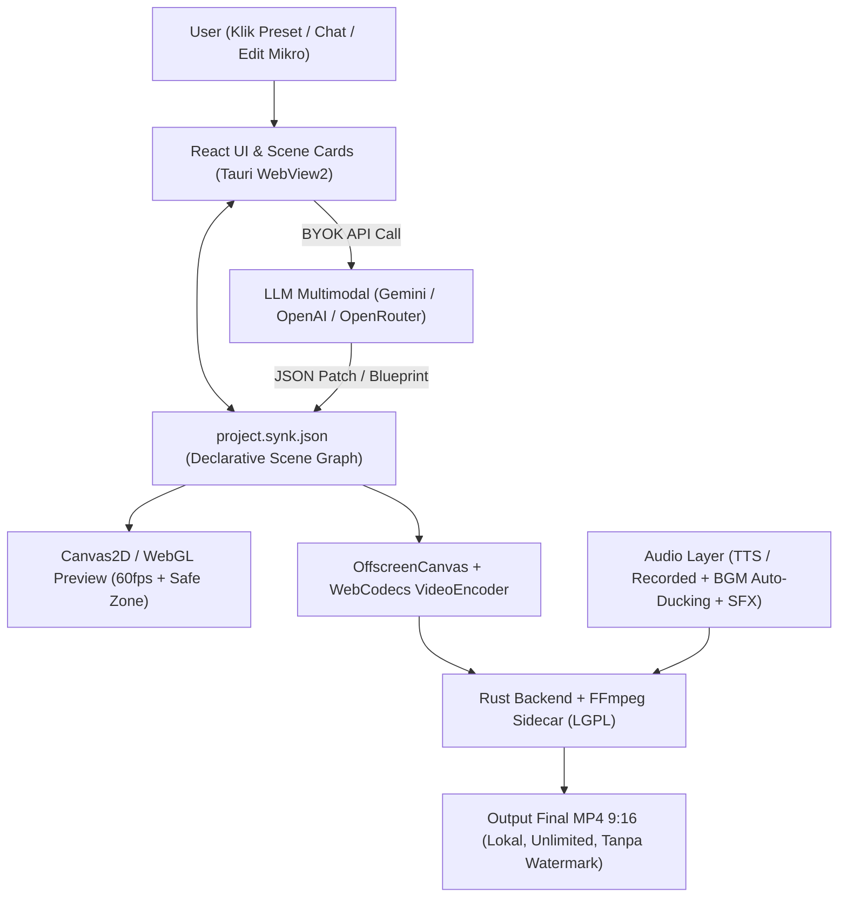

# Synkcut — Master Blueprint & PRD (Product Requirements, Tech Spec & Roadmap)

> **Nama Produk:** **Synkcut** *(Sync + Cut — dibaca "Sing-kat")*
> **Tagline:** *"Suara, footage, dan motion otomatis sinkron dalam hitungan menit."*
> **Target Rilis v1:** Desktop Windows · UI Bahasa Indonesia (istilah editing tetap Bahasa Inggris) · BYOK · Footage Lokal
> **Dokumen ini berfungsi sebagai sumber kebenaran utama (Source of Truth) & arahan pengembangan untuk AI maupun developer.**

---

## 1. Visi, Masalah, dan Positioning

### Masalah yang Diselesaikan
1. **Produktivitas Tim Kecil & Kreator:** Content creator solo dan UMKM butuh produksi video pendek (Reels, TikTok, Shorts, Ads) secara rutin dan bervolume tinggi, tetapi sewa freelancer mahal per video dan editing manual di timeline memakan waktu lama.
2. **Hambatan Teknis "Vibe-Editing":** Alur kerja AI video modern (LLM + Remotion/HyperFrames + Python + FFmpeg) terbukti menghasilkan motion yang tajam, namun **terlalu teknis** bagi kreator dan marketer non-IT (ribet install dependency, terminal, dan error kode).
3. **Kelelahan Langganan & "Credit Burn":** Kompetitor cloud SaaS mahal (\$20–\$99/bulan) dan sering membakar kredit saat hasil generasi AI gagal atau butuh revisi kecil.

### Positioning Unik Synkcut
**"Canva / CapCut-nya Agentic AI Video untuk Kreator & UMKM"** — membungkus kekuatan *programmatic motion graphics* & *AI director* ke dalam aplikasi desktop **zero-setup** yang ringan:
- **Zero Blank Canvas:** Klik-klik preset racikan konten + tetap bebas revisi via AI chat.
- **Anti-Credit Burn:** Render lokal **unlimited tanpa watermark** + model **BYOK** (Bring Your Own Key) + edit mikro **0 token AI**.
- **Multi-Format Konten (Bukan Hanya Iklan):** Mendukung format Iklan/Promo, Edukasi/Tips, Storytelling/Opini, dan Review/Unboxing.

---

## 2. Ringkasan Riset Kompetitor & White Space

| Kompetitor | Kekuatan Utama | Celah / Kelemahan yang Diisi Synkcut |
| :--- | :--- | :--- |
| **HyperFrames / Studio** *(HeyGen)* | HTML/GSAP -> render lokal gratis, deterministik, agent-native. | DNA masih *developer-first* (kode/CLI), kanvas kosong tanpa struktur konten atau preset klik-klik, fitur AI bawaan mengarah ke Pro (\$25/bln). |
| **bikinmotion.id** | Validasi pasar Indonesia: racikan prompt Hook/Style/Motion sekali bayar + galeri komunitas. | **Bukan aplikasi editor.** User tetap harus copy-paste prompt dan setup render sendiri di luar platform. |
| **OpenCut** | Open-source Rust + WASM + React, lokal & privasi tinggi. | UX masih timeline tradisional manual ala CapCut, bukan AI content builder. |
| **Creatify / InVideo AI / Loopdesk** | Cepat menghasilkan variasi konten/iklan lewat prompt. | Komplain masif soal *credit burn* (gagal render tetap bayar), mahal, dan footage harus di-upload ke cloud. |
| **CapCut Desktop** | Template & ekosistem besar. | Harga Pro naik agresif, banyak fitur lama dikunci paywall, editing masih dominan manual timeline. |

---

## 3. Arsitektur Teknis (Ringan, Cepat, Zero-Setup)

### Stack Utama v1
- **Desktop Shell & Backend:** **Tauri v2 (Rust)** — memakai WebView2 bawaan Windows (tanpa bundle Chromium penuh), penyimpanan API Key terenkripsi via **Windows Credential Manager**, manajemen proyek lokal (`My Projects`), dan orkestrasi proses media.
- **Frontend & Live Preview:** **React + TypeScript + Tailwind CSS** + **HTML5 Canvas / WebGL** untuk *preview* 60fps *motion graphics* & *kinetic captions*.
- **Export Pipeline:** **OffscreenCanvas + WebCodecs (`VideoEncoder`) + Mediabunny** (akselerasi hardware GPU laptop) dipadukan dengan **FFmpeg & FFprobe Sidecar** (`externalBin` Tauri v2) untuk audio mixing (*voiceover* + BGM *auto-ducking* + SFX) dan *muxing* MP4 final.
- **Estimasi Beban Sistem:** Ukuran installer **~50–80 MB** (vs Electron 300–500 MB+), RAM saat idle **~60–100 MB** — ramah untuk laptop standar RAM 8–16 GB.

### Catatan Lisensi FFmpeg
Untuk menjaga fleksibilitas komersialisasi (*closed-source* di masa depan), binary FFmpeg yang di-bundle sebagai sidecar wajib menggunakan build **LGPL** (bukan GPL `libx264`). Encoding H.264 ditangani langsung oleh **WebCodecs** / hardware encoder OS Windows.

### Strategi Audio v1 (Tanpa ElevenLabs Dulu)
- **Text-to-Speech (TTS):**
  1. **BYOK TTS (Utama & Aman Komersial):** Memakai API key yang sama milik user (**Gemini TTS / OpenAI TTS**) — suara Bahasa Indonesia natural, nol akun tambahan.
  2. **Edge TTS (Opsi Gratis Bawaan):** Suara Indonesia (`Ardi` & `Gadis`) dipanggil langsung dari Rust via WebSocket untuk opsi coba-coba gratis *(butuh internet)*.
- **Suara Sendiri + Auto-Sync:**
  - Rekam langsung dari mic atau upload WAV/MP3 -> Rust menormalkan audio + opsi **Auto Trim Silence** (potong jeda diam > 0,4 detik) -> ambil **word-level timestamps** via BYOK Transcription API (cepat & nol download model besar di v1; `whisper-rs` offline masuk Phase 2).

---

## 4. Otak Aplikasi: JSON Scene Graph & AI Pipeline

### Pemisahan 2 Lapisan (`project.synk.json`)
1. **Template / Blueprint Layer:** Format konten, caption preset, warna aksen, motion, transisi, overlay, SFX, BGM, dan pola pacing. *(Lapisan ini hanya berukuran beberapa KB—menjadi pondasi instan untuk fitur **Community Remix / Use as Sample** di Phase 2.)*
2. **Content / Asset Layer:** Path footage lokal milik user, teks skrip, file voiceover, dan array `words[]` (*word-level timestamps*).

### Alur AI Pipeline (4 Tahap Presisi & Hemat Token)
1. **Step A — Script & Opsi Hook:** Input topik/produk + Format Konten + Gaya Bahasa (*Santai, Profesional, Persuasif, Lucu*) + Target Durasi (15s/30s/60s) -> AI menghasilkan **3 opsi Hook** + draft Body + CTA.
2. **Step B — Kunci Audio & Timestamps DULU:** Audio (TTS atau rekaman sendiri) diproses terlebih dahulu untuk memperoleh durasi nyata & timestamp tiap kata. Durasi setiap scene dikunci otomatis mengikuti suara asli (**bukan tebak-tebakan AI**).
3. **Step C — Multimodal AI Director:** Rust mengekstrak **1–2 thumbnail resolusi kecil** dari tiap footage lokal user, lalu mengirimkannya bersama timestamps & pilihan preset ke model multimodal (Gemini/OpenAI). AI benar-benar "melihat" isi klip dan memasangkannya secara cerdas ke segmen Hook/Body/CTA.
4. **Step D — AI Copilot Chat (*JSON Patching*):** Revisi lewat chat hanya menghasilkan *patch* JSON kecil (bukan generate ulang seluruh proyek), sehingga super cepat, hemat token BYOK, dan tidak menimpa editan manual user.

---

## 5. Kurasi Paket Preset & Visual Overlay v1

Dirancang dengan prinsip **"sedikit tapi cakep, tajam, dan terpakai harian"**:

- **4 Format Konten:** `Iklan / Promo Produk`, `Edukasi / Tips`, `Storytelling / Opini`, `Review / Unboxing`.
- **5 Style & Kinetic Caption:** `Bold Pop`, `Clean Minimal`, `Kinetic Punch`, `Luxury Editorial`, `Neon Tech`.
- **5 Motion Footage:** `Zoom Punch`, `Smooth Ken Burns`, `Shake Impact`, `Slide Reveal`, `Static Clean`.
- **5 Transisi:** `Hard Cut`, `Whip Pan`, `Pop Zoom`, `Glitch Flash`, `Smooth Crossfade`.
- **6 Visual Overlay (Riset Tren Short-Form):**
  1. `Hook Headline Card` *(3 detik pertama, ramah sound-off)*
  2. `Native Notification Banner` *(gaya notif HP / DM / chat — efek anti-ad)*
  3. `Promo / Callout Badge` *(tag harga, diskon, label poin `#1`)*
  4. `Doodle & Highlight Marker` *(coretan garis bawah, lingkaran penunjuk, frosted box)*
  5. `Split-Screen / PiP` *(pembicara + demo produk/B-roll)*
  6. `Progress Bar + Auto Safe Zone` *(otomatis menjauhi area UI TikTok/Reels: 130px atas & 480px bawah pada 1080×1920)*
- **Audio Pack Bawaan (100% Royalty-Free, ~5–8 MB total):**
  - **12 SFX:** `Whoosh Cepat`, `Whoosh Halus`, `Pop Teks`, `Ding Notif`, `Impact Boom`, `Riser`, `Camera Shutter`, `Keyboard Click`, `Cash Register`, `Vinyl Scratch`, `Glitch Zap`, `Swoosh Reverse`.
  - **6 BGM Mood** *(otomatis Auto-Ducking -14dB saat suara bicara masuk)*: `Upbeat Promo`, `Lo-Fi Edukasi`, `Cinematic Story`, `Tech Modern`, `Trendy Funk`, `Chill Aesthetic`.

---

## 6. Standar Desain UI/UX — Impeccable *Operate* Mode

Seluruh antarmuka Synkcut wajib dirancang mengikuti prinsip **Impeccable (`https://impeccable.style/`) — Mode `Operate`**:
- Fokus pada *scanability*, konsistensi, presisi detail native desktop, dan **nol AI slop** (tanpa gradasi ungu generik, tanpa glow murahan, tanpa emoji berantakan di label UI, tanpa kesan "dummy/template").
- Saat fase pembangunan UI dimulai, wajib menyusun `PRODUCT.md` dan `DESIGN.md` terlebih dahulu serta melakukan verifikasi visual nyata di ukuran layar desktop (`impeccable critique / audit / polish / harden`).

### Sistem Tema & Visual
- **Dual Theme:** **Dark Studio** *(default — permukaan arang bersih untuk fokus pada preview video)* + **Light Studio** *(opsi ganti tema instan yang sama matangnya, kontras terkalibrasi, bukan sekadar inversi warna)*.
- **Bahasa UI:** Full Bahasa Indonesia natural + istilah editing standar tetap Bahasa Inggris (`Footage`, `Hook`, `CTA`, `Scene`, `Motion`, `Transition`, `SFX`, `Backsound`, `Voiceover`, `Safe Zone`, `Preset`, `Export`, `Render`).
- **Kode Warna Peran Scene (Fungsional):** `Hook` (Amber) · `Body` (Cyan/Biru) · `CTA / Payoff` (Emerald).
- **Tipografi:** Sans-serif modern berkarakter presisi (`IBM Plex Sans`) + monospace (`JetBrains Mono`) dengan *tabular numerals* khusus untuk durasi & timecode (`00:03.2`).

### Peta 5 Layar Utama v1
1. **Onboarding BYOK:** Pilih provider (Gemini / OpenAI / OpenRouter) -> panduan bernomor 3 langkah -> input API key -> **"Tes Koneksi"** (juga dapat diakses ulang melalui menu `Pengaturan AI` pada sidebar).
2. **Beranda Desktop (`My Projects` & `Sample Bawaan`):**
   - **Sidebar Kiri Native (`228px`):** Identitas Synkcut, tombol **`+ Buat Konten Baru`** (membuka pemilih 4 Format Konten), navigasi `My Projects`, `Sample Bawaan`, `Komunitas (Phase 2)`, `Pengaturan AI`, serta footer status BYOK & switcher Dark/Light Studio.
   - **Workspace `My Projects`:** Toolbar pencarian, filter format, dan toggle **Grid Poster 9:16 (default) ↔ List Rapi**. Setiap proyek menampilkan **thumbnail visual 9:16 nyata** hasil render Canvas engine (gaya caption, aksen warna, overlay), durasi, serta aksi cepat (*Buka, Duplikat, Ganti Nama inline, Hapus konfirmasi inline*).
   - **Workspace `Sample Bawaan`:** Galeri 4 sample template dengan preview poster 9:16 nyata siap klik **"Pakai Sample Ini"**.
3. **Wizard Racik Konten (3 Langkah):**
   - *Langkah 1:* Ide/Produk -> Generate 3 Opsi Hook + Script -> Edit cepat.
   - *Langkah 2:* Drop Footage Lokal *(+ tombol `AI Footage: Flow / Seedance` berlabel `Coming Soon`)* -> Pilih TTS atau Rekam/Upload Suara Sendiri *(+ Auto Trim Silence)*.
   - *Langkah 3:* Klik-klik Kartu Preset (Caption, Motion, Transisi, Overlay, BGM, Auto-SFX) -> **"Racik Video"**.
4. **Studio Editor (3 Kolom Presisi):**
   - *Kiri:* **Scene Cards** (drag urutan, klik teks edit instan, tukar footage, ubah preset/overlay — **0 token AI**).
   - *Tengah:* **Live Canvas Preview 9:16** (60fps, scrubber, toggle `Safe Zone`, tombol `Export MP4`).
   - *Kanan:* **AI Copilot Chat** (revisi berbasis JSON Patch + quick suggestion chips + Undo/Redo).
5. **Modal Export Lokal:** Pilih `1080p` / `720p`, `30` / `60` FPS, folder tujuan -> progress bar real-time -> **"Buka Folder"** & **"Putar Video"**.

---

## 7. Peta Scope (MVP -> Growth -> Ecosystem)

| Phase 1 — MVP (v1.0 Windows) | Phase 2 — Growth & Community Moat | Phase 3 — Ecosystem & Scale |
| :--- | :--- | :--- |
| Onboarding BYOK + OS Keychain | **Community Hub** (share video + blueprint JSON) | Aktivasi **Google Flow / Seedance** |
| `My Projects` lokal + Duplicate | **"Use as Sample / Remix"** karya komunitas | **Brand Kit** (logo, font, warna brand) |
| Footage lokal + Flow/Seedance *(Coming Soon)* | **Batch Hook Generator** (1 klik -> 3–5 variasi Hook) | Opsi Cloud/Credit *(jika ekspansi non-BYOK)* |
| 4 Format Konten + 3 Opsi Hook AI | Integrasi **ElevenLabs** (BYOK) & **Whisper Offline** (`whisper-rs`) | |
| TTS (BYOK + Edge) + Suara Sendiri Auto-Sync | Dukungan **macOS** | |
| Kurasi Preset & 6 Overlay + Audio Pack | | |
| Hybrid Studio (Dark & Light Mode, Impeccable UI) | | |
| 3–5 Sample Template Bawaan (Remix Lokal) | | |
| Export MP4 Lokal 9:16 tanpa watermark | | |

---

## 8. Roadmap Eksekusi (Milestone Bertahap)

Prinsip eksekusi: **Buktikan risiko teknis terbesar paling awal (Milestone 0)**. Jangan bangun seluruh layar sebelum pipeline export video lokal & audio sync terbukti mulus di Windows.

1. **Milestone 0 — Proof of Concept (PoC) Engine Inti**
   - Inisialisasi repo **Tauri v2 (Rust) + React/TS/Tailwind**.
   - Validasi end-to-end: muat 1 footage lokal + 1 file audio + gambar 1 kinetic caption & overlay di `OffscreenCanvas` -> encode via **WebCodecs (`VideoEncoder`) + Mediabunny** -> muxing audio via **FFmpeg Sidecar (LGPL)** -> hasilkan file `test_output.mp4` 1080×1920 mulus di Windows.
2. **Milestone 1 — Fondasi Design System (Impeccable) + Shell + BYOK + `My Projects`**
   - Susun `PRODUCT.md` & `DESIGN.md` (token Dark & Light Studio, tipografi, komponen inti anti-slop).
   - Implementasi penyimpanan API Key aman (Windows Credential Manager), layar Onboarding BYOK, dan manajemen proyek lokal (`project.synk.json`).
3. **Milestone 2 — Wizard Racik Konten + Audio Pipeline + Multimodal AI Director**
   - Alur Step 1–3: AI Script & 3 Opsi Hook, import footage lokal + ekstraksi thumbnail di Rust, TTS (BYOK + Edge TTS), rekam/upload suara sendiri + Auto-Trim Silence + Word-Level Timestamps, dan tombol Flow/Seedance (`Coming Soon`).
4. **Milestone 3 — Canvas Motion, Preset & Overlay Engine**
   - Implementasi penuh 5 Style Caption, 5 Motion, 5 Transisi, 6 Visual Overlay, Safe Zone overlay, serta 12 SFX + 6 BGM dengan Auto-Ducking.
5. **Milestone 4 — Hybrid Studio 3 Kolom + AI Copilot (JSON Patch) + Sample Bawaan**
   - Scene Cards interaktif (drag-drop, edit mikro 0 token, Undo/Redo), AI Copilot Chat berbasis JSON Patch, serta 3–5 Sample Bawaan siap remix.
6. **Milestone 5 — Export Polish, Impeccable Audit & Windows Installer**
   - Modal Export lengkap dengan progress bar & estimasi waktu, pengujian performa di footage panjang/berat, *Impeccable critique/audit/polish/harden* (Dark & Light Mode), dan build installer Windows (`.msi` / `.exe`).
