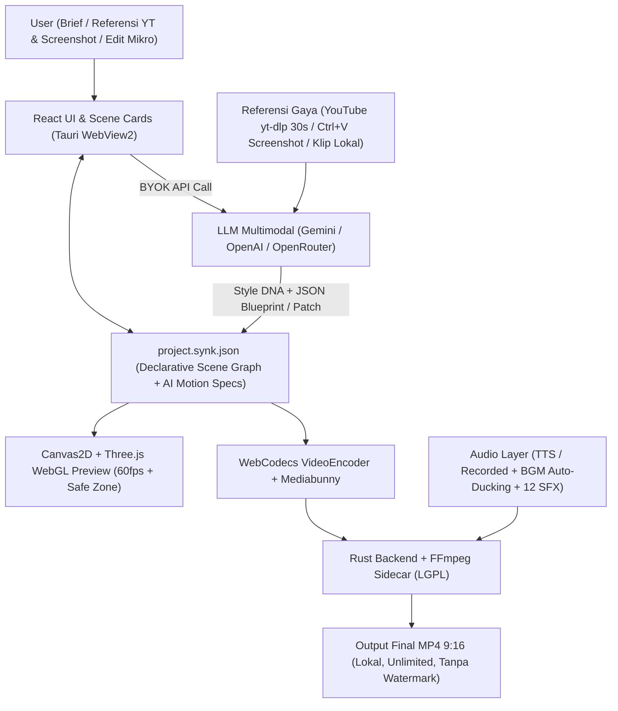

# Synkcut — Master Blueprint & PRD (Product Requirements, Tech Spec & Roadmap)

> **Nama Produk:** **Synkcut** *(Sync + Cut — dibaca "Sing-kat")*
> **Tagline:** *"Suara, footage, dan motion otomatis sinkron dalam hitungan menit."*
> **Target Rilis v1.0 (Selesai) → v1.1 (Aktif):** Desktop Windows · UI Bahasa Indonesia (istilah editing tetap Bahasa Inggris) · BYOK · **Hybrid Footage Lokal + AI Motion Video**
> **Dokumen ini berfungsi sebagai sumber kebenaran utama (Source of Truth) & arahan pengembangan untuk AI maupun developer.**

---

## 1. Visi, Masalah, dan Positioning

### Masalah yang Diselesaikan
1. **Produktivitas Tim Kecil & Kreator:** Content creator solo dan UMKM butuh produksi video pendek (Reels, TikTok, Shorts, Ads) secara rutin dan bervolume tinggi, tetapi sewa freelancer mahal per video dan editing manual di timeline memakan waktu lama.
2. **Hambatan Teknis "Vibe-Editing" & Motion Video:** Alur kerja AI video modern (LLM + Remotion/HyperFrames + Python/Playwright + FFmpeg) terbukti menghasilkan motion graphics tajam (diagram cara kerja, grafik animasi, stick-figure, 3D teardown), namun **terlalu teknis** bagi kreator non-IT dan merepotkan jika harus bolak-balik menggabungkan suara, subtitle, SFX, serta BGM secara manual.
3. **Kelelahan Langganan & "Credit Burn":** Kompetitor cloud SaaS mahal (\$20–\$99/bulan) dan sering membakar kredit saat hasil generasi AI gagal atau butuh revisi kecil.
4. **Kreator Tanpa Footage (*Faceless / Edukasi Tech & Bisnis*):** Banyak kreator punya ide dan skrip tajam (*cara kerja internet, edukasi finansial, review teknologi*) namun tidak punya footage kamera/B-roll—butuh **AI Motion Video** siap pakai tanpa buka After Effects atau terminal.

### Positioning Unik Synkcut
**"Canva / CapCut-nya Agentic AI Video + AI Motion Studio untuk Kreator & UMKM"** — membungkus kekuatan *programmatic motion graphics* & *AI director* ke dalam aplikasi desktop **zero-setup** yang ringan:
- **Hybrid Footage + AI Motion Video *(v1.1)*:** Setiap scene bebas memilih **Footage Lokal** atau **AI Motion** (bisa 100% tanpa footage, 100% footage, atau dicampur dalam satu video!).
- **Zero Blank Canvas + Referensi Gaya:** Klik-klik preset racikan konten, tempel referensi (Link YouTube / `Ctrl+V` Screenshot / Klip Lokal), dan tetap bebas revisi via AI Director chat.
- **Anti-Credit Burn:** Render lokal **unlimited tanpa watermark** + model **BYOK** (Bring Your Own Key) + edit mikro **0 token AI** (termasuk edit teks, node diagram, angka grafik, karakter stick-figure, hingga komponen 3D).
- **Multi-Format Konten:** Mendukung format Iklan/Promo, Edukasi/Tips, Storytelling/Opini, dan Review/Unboxing.

---

## 2. Ringkasan Riset Kompetitor & White Space

| Kompetitor / Ekosistem | Kekuatan Utama | Celah / Kelemahan yang Diisi Synkcut |
| :--- | :--- | :--- |
| **HyperFrames / Studio** *(HeyGen)* | HTML/GSAP → render lokal gratis, deterministik, agent-native. | DNA masih *developer-first* (kode/CLI), kanvas kosong tanpa struktur konten atau preset klik-klik, fitur AI bawaan mengarah ke Pro (\$25/bln). |
| **Claude Motion Skills (`claude-animation-skills`, `remotion-dev/skills`)** | Hasil motion tajam (*minimal-graphics, stick-figure, graph, 3D breakdown, Remotion*). | Wajib terminal, Python/Playwright/Node CLI, output biasanya klip bisu 5–7 detik tanpa studio editor, tanpa sinkronisasi suara/caption/BGM/SFX terpadu. |
| **bikinmotion.id** | Validasi pasar Indonesia: racikan prompt Hook/Style/Motion sekali bayar + galeri komunitas. | **Bukan aplikasi editor.** User tetap harus copy-paste prompt dan setup render sendiri di luar platform. |
| **OpenCut** | Open-source Rust + WASM + React, lokal & privasi tinggi. | UX masih timeline tradisional manual ala CapCut, bukan AI content & motion builder. |
| **Creatify / InVideo AI / Loopdesk** | Cepat menghasilkan variasi konten/iklan lewat prompt. | Komplain masif soal *credit burn* (gagal render tetap bayar), mahal, dan footage harus di-upload ke cloud. |
| **CapCut Desktop** | Template & ekosistem besar. | Harga Pro naik agresif, banyak fitur lama dikunci paywall, belum bisa auto-generate diagram/motion edukasi dari ide. |

---

## 3. Arsitektur Teknis (Ringan, Cepat, Zero-Setup)

### Stack Utama (v1.0 & v1.1)
- **Desktop Shell & Backend:** **Tauri v2 (Rust)** — memakai WebView2 bawaan Windows (tanpa bundle Chromium penuh), penyimpanan API Key terenkripsi via **Windows Credential Manager**, manajemen proyek lokal (`My Projects`), dan orkestrasi media.
- **Frontend & Live Preview:** **React + TypeScript + Tailwind CSS** + **HTML5 Canvas2D & Three.js WebGL (lokal offline, tanpa CDN)** untuk *preview* 60fps *footage*, **5 engine AI Motion**, dan *kinetic captions*.
- **Export Pipeline:** **Canvas2D / Offscreen WebGL Composite → WebCodecs (`VideoEncoder`) + Mediabunny** (akselerasi hardware GPU laptop) dipadukan dengan **FFmpeg & FFprobe Sidecar (LGPL)** untuk audio mixing (*voiceover* + BGM *sidechaincompress auto-ducking* + 12 SFX *adelay*) dan *muxing* MP4 final.
- **Tool Opsional Referensi YouTube *(v1.1)*:** **`yt-dlp.exe`** (Unlicense, disimpan & dapat di-update 1 klik di `%LOCALAPPDATA%\Synkcut\tools\`) khusus untuk sampling cuplikan ringan (`0:00–0:30`, `≤360p`) → ekstraksi 4–6 frame JPEG → hapus video sementara otomatis.
- **Beban Sistem Terverifikasi (v1.0):** Binary release `synkcut.exe` **17,1 MB**, installer NSIS lengkap dengan FFmpeg/FFprobe LGPL **87,5 MB** (vs Electron 300–500 MB+), ramah laptop standar RAM 8–16 GB.

### Catatan Lisensi FFmpeg & Tools
- Binary FFmpeg/FFprobe sidecar menggunakan build **LGPL** (bukan GPL `libx264`). Encoding H.264 ditangani oleh **WebCodecs** / hardware encoder OS Windows.
- `yt-dlp` berlisensi **Unlicense** (public domain) dan dipakai secara *ephemeral* khusus sampling frame referensi gaya (file video temp langsung dihapus segera setelah frame JPEG diekstrak).

### Strategi Audio v1 (Tanpa ElevenLabs Dulu)
- **Text-to-Speech (TTS):**
  1. **BYOK TTS (Utama & Aman Komersial):** Memakai API key yang sama milik user (**Gemini 2.5 Flash Native TTS / OpenAI TTS**) — suara Bahasa Indonesia natural, nol akun tambahan.
  2. **Windows Offline TTS (Gratis Tanpa Key):** Sintesis lokal lewat Windows SAPI agar user tanpa key tetap bisa mencoba end-to-end.
- **Suara Sendiri + Auto-Sync:**
  - Rekam langsung dari mic atau upload WAV/MP3 → Rust menormalkan audio + opsi **Auto Trim Silence** (FFmpeg `silenceremove` > 0,4 detik) → ambil **word-level timestamps** via BYOK Transcription API dengan fallback proporsional otomatis (`whisper-rs` offline masuk Phase 2).

---

## 4. Otak Aplikasi: JSON Scene Graph & AI Pipeline

### Pemisahan 2 Lapisan (`project.synk.json` — Kompatibel v1.0 & v1.1)
1. **Template / Blueprint Layer:** Format konten, caption preset, warna aksen, motion, transisi, overlay, SFX, BGM, tema `AI Motion`, dan pola pacing. *(Menjadi pondasi **Community Remix / Use as Sample** di Phase 2.)*
2. **Content / Asset Layer:**
   - Per scene mendukung **`visualSource: "footage" | "motion"`** *(default `"footage"` untuk backward-compatibility penuh dengan proyek v1.0)*.
   - Jika `"footage"`: path footage lokal (`path`, `secondaryPath`, `trimStartMs`).
   - Jika `"motion"`: deklarasi JSON **`aiMotion`** (`engine`, `theme`, `title`, `subtitle`, `takeaway`, dan `config` spesifik engine) — **100% deterministik, tanpa kode mentah LLM yang rawan error syntax!**
   - Teks skrip, file voiceover, array `words[]` (*word-level timestamps*), serta ringkasan opsional `styleReference` (*Style DNA*).

### Alur AI Pipeline (5 Tahap Presisi & Hemat Token — v1.1)
1. **Step 0 *(Opsional)* — Analisis Referensi Gaya (`Style DNA`):**
   - Menerima **Link YouTube/Shorts**, **`Ctrl+V` Screenshot / Upload (1–3 gambar)**, atau **Klip Video Lokal**.
   - **Smart 3-Layer Pipeline untuk Link YouTube:**
     1. *Layer 1 (`yt-dlp` 30s Frame Sampler — Universal semua BYOK):* Ambil potongan `0:00–0:30` kualitas ringan (`≤360p`) → FFmpeg ekstrak 4–6 frame JPEG kunci → hapus file temp → tampilkan strip preview frame di UI Wizard.
     2. *Layer 2 (Gemini Direct URL Fallback):* Jika `yt-dlp` belum dipasang atau kena bot-check YouTube, khusus Gemini BYOK langsung kirim URL YouTube via native `fileUri` (0 MB download lokal).
     3. *Layer 3 (`oEmbed + Thumbnail` + `Ctrl+V` Hint):* Fallback aman untuk OpenAI/OpenRouter agar alur tidak pernah buntu.
   - Multimodal AI mengekstrak **`Style DNA`** (palet & tema warna, mood gelap/terang, tempo pacing, tipe motion dominan, gaya caption) sebagai panduan konsisten ke seluruh tahap berikutnya.
2. **Step A — Script & 3 Opsi Hook:** Input topik/produk + Format Konten + Gaya Bahasa (*Santai, Profesional, Persuasif, Lucu*) + Target Durasi (15s/30s/60s) + *Style DNA* → AI menghasilkan **3 opsi Hook** + draft Body + CTA.
3. **Step B — Kunci Audio & Timestamps DULU:** Audio (TTS atau rekaman sendiri) diproses terlebih dahulu untuk memperoleh durasi nyata & timestamp tiap kata. Durasi setiap scene dikunci otomatis mengikuti suara asli (**bukan tebak-tebakan AI**).
4. **Step C — Multimodal AI Director (Hybrid Footage + AI Motion):**
   - Mode **AI Motion (Tanpa Footage):** AI Director merancang **JSON `aiMotion`** per scene (memilih engine paling pas untuk tiap segmen: mis. *Stick-Figure* di Hook → *Flow & Diagram* di Body 1 → *Motion Chart* di Body 2 → *Tech Cards* di CTA) mengikuti *Style DNA*.
   - Mode **Footage Lokal:** Rust mengekstrak thumbnail kecil tiap footage lokal → AI memasangkan klip ke scene paling cocok.
   - Mode **Campur Footage + AI Motion:** Klip lokal dipasang ke scene relevan, sementara scene yang butuh visualisasi konsep/data otomatis diisi **AI Motion**.
5. **Step D — AI Copilot Chat (*JSON Patching* + Path Guard + 1-Klik Batalkan):** Revisi lewat chat hanya menghasilkan *patch* JSON kecil (mendukung fokus `selectedSceneId`, ganti engine `AI Motion`, edit parameter diagram/chart/3D, maupun ganti style global) dengan pelindung path media lokal & tombol *Batalkan patch ini*.

---

## 5. Kurasi Preset, Visual Overlay & 5 Engine `AI Motion`

### 5.1 Preset Editing, Overlay & Audio Pack *(Terimplementasi di v1.0)*
- **4 Format Konten:** `Iklan / Promo Produk`, `Edukasi / Tips`, `Storytelling / Opini`, `Review / Unboxing`.
- **5 Style & Kinetic Caption:** `Bold Pop`, `Clean Minimal`, `Kinetic Punch`, `Luxury Editorial`, `Neon Tech`.
- **5 Motion Footage:** `Zoom Punch`, `Smooth Ken Burns`, `Shake Impact`, `Slide Reveal`, `Static Clean`.
- **5 Transisi Visual:** `Hard Cut`, `Whip Pan`, `Pop Zoom`, `Glitch Flash`, `Smooth Crossfade`.
- **6 Visual Overlay:** `Hook Headline Card`, `Native Notification Banner`, `Promo / Callout Badge`, `Doodle & Highlight Marker`, `Split-Screen / B-Roll`, `Progress Bar + Auto Safe Zone (130px atas / 480px bawah pada 1080×1920)`.
- **Audio Pack Bawaan (100% Royalty-Free, sintesis lokal cached WAV):**
  - **12 SFX:** `Whoosh Cepat`, `Whoosh Halus`, `Pop Teks`, `Ding Notif`, `Impact Boom`, `Riser`, `Camera Shutter`, `Keyboard Click`, `Cash Register`, `Vinyl Scratch`, `Glitch Zap`, `Swoosh Reverse`.
  - **6 BGM Mood *(Auto-Ducking -14 dB)*:** `Upbeat Promo`, `Lo-Fi Edukasi`, `Cinematic Story`, `Tech Modern`, `Trendy Funk`, `Chill Aesthetic`.

### 5.2 5 Engine **`AI Motion`** Native *(Target v1.1 — 100% Lokal, Tanpa Python/Playwright)*
Menyerap pola terbaik dari ekosistem *declarative JSON motion skills* (`minimal-graphics`, `graph`, `stick-figure`, `breakdown`) dan prinsip koreografi `Remotion` / `Motion Canvas`:

| # | Engine `AI Motion` | Pola / Sub-Mode | Kegunaan Utama | Parameter Edit 0-Token di Studio |
| :--- | :--- | :--- | :--- | :--- |
| 1 | **`Flow & Diagram`** (`flow_diagram`) | `flow`, `spread`, `cycle`, `converge`, `compare` | Cara kerja sistem/internet (*Browser → DNS → Server*), siklus, efek viral, perbandingan konsep | Pola, judul, daftar langkah/node (maks 6), label singkat, takeaway, warna tema |
| 2 | **`Motion Chart`** (`motion_chart`) | `bar`, `line`, `stat_counter` | Data angka, pertumbuhan, perbandingan kecepatan/biaya/ROAS | Judul, daftar pasangan `(label, nilai)`, prefix/suffix (`Rp`, `%`, `ms`), callout pertumbuhan otomatis (`↑ 7.5x`) |
| 3 | **`Tech & UI Cards`** (`tech_cards`) | `staggered_steps`, `terminal_code`, `comparison_split` | Poin 1-2-3 terstruktur, cuplikan terminal/kode ber-highlight, *Before vs After / Pros vs Cons* | Judul, daftar kartu/baris kode/kolom perbandingan, highlight baris aktif |
| 4 | **`Stick-Figure Story`** (`stick_figure`) | Panggung `room`, `office`, `street`, `classroom`, `plain` | Analogi cerita relatable (*mis. DNS seperti buku telepon*), storytelling & edukasi ringan | Setting panggung, 1–3 karakter (`person`/`cat`/`dog`), properti, beat aksi (`walk`, `talk`, `idea`, `point`, `surprised`, `laugh`), balon dialog |
| 5 | **`3D Product Breakdown`** (`breakdown_3d`) | `Three.js` WebGL lokal offline (`turntable` + `exploded view`) | Bedah hardware/produk lapis demi lapis (*smartphone, keyboard, headphone, kamera, komponen PC*) | Daftar part 3D (`name`, `shape`, `size`, `material`, `level` ledakan), sudut putar, tema gelap/terang |

### Aturan Koreografi & Kontrak Layout Aman `AI Motion` (Wajib)
1. **Kontrak Layout 9:16 Anti-Tabrakan:**
   - **`0%–7%` (0–130px):** Top Safe Zone & Progress Bar tipis.
   - **`10%–59%` (190–1130px):** **Panggung Bersih `AI Motion`** — seluruh diagram, grafik, stick-figure, UI card, dan model 3D wajib berada di area ini.
   - **`63%–74%` (1210–1420px):** **Zona Kinetic Caption** — selalu terbaca kontras di atas tema `AI Motion` apa pun.
   - **`75%–100%` (1440–1920px):** Bottom Safe Zone UI TikTok/Reels (kosong dari teks penting).
2. **Prinsip Koreografi Anti-Kaku:**
   - Haram animasi linear polos — wajib *spring physics* & `easeOutExpo`.
   - **Staggered choreography:** elemen/kartu/bar masuk berurutan dengan selisih 90–180ms.
   - **Multi-property entrance:** kombinasikan `opacity + scale + translateY`.
   - **5 Tema Kanvas `AI Motion`:** `carbon` (gelap karbon + emerald/amber), `paper` (editorial krem/putih + tinta pekat), `coral` (hangat modern), `mint` (segar bersih), `blue` (tech navy/cyan) — semua bertekstur halus/grid, bukan blok warna datar.
   - **Disiplin Label Mikro:** Maksimal 3–4 kata per node/label agar tajam di layar HP.

---

## 6. Standar Desain UI/UX — Impeccable *Operate* Mode

Seluruh antarmuka Synkcut wajib dirancang mengikuti prinsip **Impeccable (`https://impeccable.style/`) — Mode `Operate`**:
- Fokus pada *scanability*, konsistensi, presisi detail native desktop, **WCAG AA ≥ 4.5:1**, minimal ukuran teks UI fungsional `11px`, dan **nol AI slop**.
- Rujukan token lengkap tersimpan di [PRODUCT.md](../PRODUCT.md) dan [DESIGN.md](../DESIGN.md).

### Sistem Tema & Visual ("Machined Carbon & Signature Emerald")
- **Dark Studio *(Default — Machined Carbon)*:** Permukaan karbon netral presisi (`#09090b` / `#111114` / `#18181c`), `--text-muted: #8e8e98`, tombol aksi utama **putih bersih (`#f4f4f6`)**, dan **Signature Emerald (`#10b981`)** yang dijatah hemat khusus untuk logo, indikator status aktif, dan atmosfer halus di Onboarding.
- **Light Studio *(Sage Mist)*:** Permukaan terang bersih (`#f3f7f5` / `#ffffff` / `#e8f0ec`), `--text-muted: #476258`, dan aksen **Deep Emerald (`#097954`)** berkontras ≥ 5.4:1.
- **Bahasa UI:** Full Bahasa Indonesia natural + istilah editing standar tetap Bahasa Inggris (`Footage`, `AI Motion`, `Hook`, `CTA`, `Scene`, `Motion`, `Transition`, `SFX`, `Backsound`, `Voiceover`, `Safe Zone`, `Preset`, `Export`, `Render`).
- **Kode Warna Peran Scene (Minimalis 6px dot):** `Hook` (Amber `#f59e0b`) · `Body` (Sky `#38bdf8`) · `CTA / Payoff` (Emerald `#10b981`).
- **Tipografi:** `IBM Plex Sans` (UI) + `JetBrains Mono` (`tabular-nums` khusus durasi, timecode, resolusi, ETA, dan JSON).

### Peta 5 Layar Utama (Diperbarui untuk v1.1)
1. **Onboarding BYOK & Pengaturan AI:** Pilih provider (Gemini / OpenAI / OpenRouter) → panduan 3 langkah → input API key → **"Tes Koneksi"** *(di v1.1 ditambah status & tombol 1-klik install/update `yt-dlp` opsional di Pengaturan AI)*.
2. **Beranda Desktop (`My Projects` & `Sample Bawaan`):**
   - Sidebar kiri native (`228px`), tombol **`+ Buat Konten Baru`**, `My Projects` (Grid Poster 9:16 ↔ List), dan `Sample Bawaan` (**5 sample v1.0 + 2 sample AI Motion v1.1**: *Cara Kerja Internet* & *Bedah Smartphone 3D*).
3. **Wizard Racik Konten (3 Langkah — Upgrade v1.1):**
   - *Langkah 1 (`Ide, Referensi & Script`):* Format Konten, Topik, **Blok Referensi Gaya Opsional** (Link YouTube/Shorts + `Ctrl+V` Screenshot 1–3 gambar + Klip Lokal → tombol `Analisis Referensi` menampilkan strip frame & ringkasan *Style DNA*) → Generate 3 Opsi Hook + Script.
   - *Langkah 2 (`Sumber Visual & Suara`):* Pilih mode visual (**`AI Motion (Tanpa Footage)`** · **`Footage Lokal`** · **`Campur Keduanya`**) + Voiceover (TTS AI / Suara Sendiri Auto-Sync + Auto Trim Silence).
   - *Langkah 3 (`Gaya & Racik`):* Pilih tema `AI Motion` + Caption + Motion/Transisi + Overlay + BGM + Auto-SFX → **"Racik Video dengan AI Director"**.
4. **Hybrid Studio Editor (Modular Rounded Studio — Upgrade v1.1):**
   - *Far-Left Slim Icon Rail (`62px`) + Left Contextual Inspector (`276px`):*
     - `Scenes`: Scene Cards interaktif (drag-drop, durasi stepper, duplikat/hapus, badge tipe `Footage` / `AI Motion`).
     - `Visual` *(menggabungkan & memperluas `Footage`)*: Switch cepat per-scene **`Footage Lokal` ↔ `AI Motion`**. Saat `AI Motion` aktif, tampil **Editor Parameter 0-Token** (ganti engine, tema kanvas, label node, data chart, karakter/dialog stick-figure, atau part 3D Breakdown secara live!).
     - `Caption`, `Motion` (gerak kamera/transisi/overlay/12 SFX), dan `Audio` (VO + 6 BGM Auto-Ducking).
   - *Tengah:* **Live Canvas Preview 9:16** (60fps, dot-grid matte, Safe Zone toggle, shortcut keyboard `Space`/`Ctrl+Z`/`Ctrl+Y`/`←`/`→`) + **2-Row Visual Scene Strip**.
   - *Kanan (`310px`):* **AI Video Director** (`AI Director` JSON Patch dengan konteks scene aktif + diff pills + 1-klik `Batalkan` & tab `AI Footage` Coming Soon).
5. **Modal Export Lokal:** Ringkasan spec (durasi, estimasi ukuran, track audio), pilih `1080p`/`720p` & `30`/`60` FPS, 3-stage progress stepper, live **ETA**, tombol **`Batalkan`**, dan **`Buka di Folder`**.

---

## 7. Peta Scope (v1.0 → v1.1 → Phase 2 → Phase 3)

| v1.0 Windows *(Selesai)* | v1.1 — AI Motion Video *(Aktif)* | Phase 2 — Growth & Community Moat | Phase 3 — Ecosystem & Scale |
| :--- | :--- | :--- | :--- |
| Onboarding BYOK + Credential Manager | **Hybrid Scene:** `Footage Lokal` ↔ `AI Motion` | **Community Hub** (share video + blueprint JSON) | Aktivasi **Google Flow / Seedance** |
| `My Projects` + 5 Sample Bawaan | **5 Engine `AI Motion` Native** (Flow/Diagram, Motion Chart, Tech Cards, Stick-Figure, 3D Breakdown) | **"Use as Sample / Remix"** karya komunitas | **Brand Kit** (logo, font, warna brand) |
| Wizard 3 Langkah + TTS & Suara Sendiri | **Referensi Gaya:** Link YouTube (`yt-dlp` 30s frame sampler + Gemini direct), `Ctrl+V` Screenshot, Klip Lokal | **Batch Hook Generator** (1 klik → 3–5 variasi Hook) | Opsi Cloud/Credit *(jika ekspansi non-BYOK)* |
| 5 Caption, 5 Motion, 5 Transisi, 6 Overlay | **Editor Parameter `AI Motion` 0-Token** di Studio | Integrasi **ElevenLabs** (BYOK) & **Whisper Offline** (`whisper-rs`) | |
| 12 SFX + 6 BGM Auto-Ducking FFmpeg | **2 Sample Bawaan AI Motion** (*Cara Kerja Internet* & *Bedah Smartphone 3D*) | Dukungan **macOS** | |
| Hybrid Studio + AI Copilot + Installer v1.0.0 | Build Installer Windows **v1.1.0** | | |

---

## 8. Roadmap Eksekusi (Milestone Bertahap)

### Fase v1.0 — Fondasi & Footage-First Studio *(SELESAI)*
1. **[x] Milestone 0 — Proof of Concept (PoC) Engine Inti:** Tauri v2 + Rust MSVC + Canvas/WebCodecs + Mediabunny + FFmpeg LGPL Sidecar.
2. **[x] Milestone 1 — Design System Impeccable + Shell + BYOK + `My Projects`:** `PRODUCT.md`, `DESIGN.md`, Machined Carbon Dark & Sage Mist Light, Credential Manager, CRUD proyek lokal.
3. **[x] Milestone 2 — Wizard Racik Konten + Audio Pipeline + Multimodal AI Director:** Script 3 Hook, TTS (Gemini/OpenAI/Offline), Rekam/Upload Suara + Auto Trim Silence, Multimodal footage matching.
4. **[x] Milestone 3 — Canvas Motion, Preset & Overlay Engine:** 5 Transisi visual, 6 Visual Overlay (termasuk Doodle Marker & Split-Screen/B-Roll), 12 SFX + 6 BGM Audio Pack & FFmpeg `sidechaincompress` Auto-Ducking.
5. **[x] Milestone 4 — Hybrid Studio 3 Kolom + AI Copilot (JSON Patch) + 5 Sample Bawaan:** Scene Cards drag-drop, durasi stepper, per-scene footage & trim start, path guard + diff pills + 1-klik batalkan, shortcut keyboard.
6. **[x] Milestone 5 — Export Polish, Impeccable WCAG AA Audit & Windows Installer v1.0.0:** Export Modal ETA/cancel, stress test 60s 1080×1920, 0 low-contrast & 0 undersized text, ikon native, installer `.exe` & `.msi`.

### Fase v1.1 — Hybrid Footage + AI Motion Video + Style Reference *(AKTIF)*
7. **[ ] Milestone 6 (v1.1a) — Schema `AI Motion` + 4 Engine 2D Native + Editor 0-Token di Studio**
   - Perluas `project.synk.json` (backward-compatible penuh dengan proyek v1.0): `scene.visualSource: "footage" | "motion"` + `scene.aiMotion` spec.
   - Bangun **4 Engine 2D Native** di Canvas2D dengan prinsip koreografi spring/staggered & Safe-Stage Layout (`10%–59%` panggung motion, `63%–74%` caption):
     1. `Flow & Diagram` (`flow`, `spread`, `cycle`, `converge`, `compare`)
     2. `Motion Chart` (`bar`, `line`, `stat_counter` + auto-callout)
     3. `Tech & UI Cards` (`staggered_steps`, `terminal_code`, `comparison_split`)
     4. `Stick-Figure Story` (panggung, karakter/pet, properti, beat aksi, panah, balon dialog)
   - Upgrade tab kiri Studio menjadi switch per-scene **`Footage Lokal` ↔ `AI Motion`** lengkap dengan form edit parameter **0 token AI** secara live 60fps & ter-export mulus via WebCodecs MP4.
8. **[ ] Milestone 7 (v1.1b) — Engine ke-5: `3D Product Breakdown` (Three.js Lokal Offline)**
   - Integrasikan `three` secara lokal (tanpa CDN/internet) dengan offscreen WebGL canvas (`preserveDrawingBuffer: true`) yang di-composite langsung ke `canvasRenderer.ts` di bawah layer overlay & Kinetic Caption.
   - Implementasikan 3D turntable, exploded view per `level`, bentuk & material studio (`slab`, `frame`, `cylinder`, `lens`, `torus`, `pcb`, `glass`, `aluminum`, `battery`, `chip`, dll.), dan callout label anti-tumpang-tindih.
   - Tambahkan editor komponen 3D 0-token di Studio + verifikasi export MP4 deterministik 30/60 FPS.
9. **[ ] Milestone 8 (v1.1c) — Referensi Gaya (`YouTube yt-dlp` + `Ctrl+V` Screenshot + Klip Lokal) + Wizard Auto-Motion + Rilis v1.1.0**
   - Implementasikan **Smart 3-Layer YouTube Reference Pipeline** di Rust (`yt-dlp` 30s `≤360p` temp frame sampler + tombol install/update 1 klik di Pengaturan AI → Gemini direct YouTube URL fallback → `oEmbed + thumbnail` fallback) + input **`Ctrl+V` Screenshot (1–3 gambar)** & **Klip Lokal** → ekstraksi **`Style DNA`**.
   - Upgrade **Wizard Racik Konten**: 3 Mode Sumber Visual (`AI Motion Tanpa Footage` · `Footage Lokal` · `Campur Keduanya`) + AI Director otomatis meracik JSON `AI Motion` beragam antar scene yang terkunci ke timestamp suara.
   - Upgrade **AI Copilot Chat** di Studio agar bisa merombak/membuat `AI Motion` per scene via JSON Patch.
   - Tambahkan **2 Sample Bawaan baru khusus AI Motion** (*Cara Kerja Internet* & *Bedah Smartphone 3D*), audit Impeccable Dark & Light Mode, dan build Windows Installer **Synkcut v1.1.0**.
